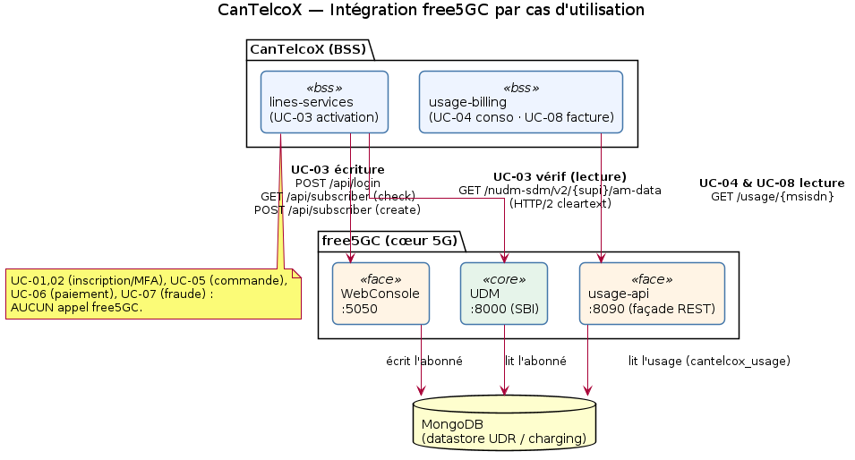
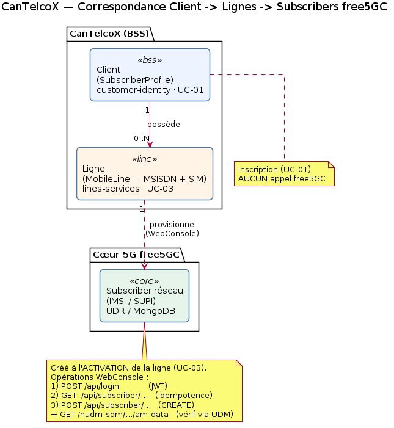

# Intégration free5GC — appels par cas d'utilisation

Ce document décrit **quand** et **comment** CanTelcoX (BSS) interagit avec le cœur 5G **free5GC**, cas d'utilisation par cas d'utilisation.



## 1. Vue d'ensemble — trois interfaces, trois directions

| Interface free5GC | Direction | Rôle | Adapter CanTelcoX |
|---|---|---|---|
| **WebConsole** (`:5050`, REST HTTP/1.1, JWT) | écriture | Provisionner l'abonné dans l'UDR (création/suppression) | `lines-services` · `Free5gcHlrAdapter` (port `HlrClient`) |
| **UDM** `Nudm_SDM` (`:8000`, SBI **HTTP/2 cleartext**) | lecture | Vérifier que le cœur sert l'abonné après provisioning | `lines-services` · `Free5gcUdmAdapter` (port `UdmClient`) |
| **usage-api** (`:8090`, REST) → MongoDB `cantelcox_usage` | lecture | Lire l'usage (charging) pour consultation et facturation | `usage-billing` · `UsageApiClient` |

> Aucune de ces interactions n'écrit/lit MongoDB **directement** depuis le BSS : le provisioning passe par la WebConsole, l'usage par `usage-api`. Le BSS reste découplé du datastore du cœur.

Toutes les interactions sont **optionnelles** (drapeaux) : sans elles, CanTelcoX tourne en mode autonome.

| Drapeau | Service | Effet |
|---|---|---|
| `HLR_ENABLED` | lines-services | `true` → provisioning réel via WebConsole ; `false` → HLR simulé |
| `UDM_VERIFY_ENABLED` | lines-services | `true` → vérification de lecture via l'UDM après provisioning |
| `USAGE_SOURCE` | usage-billing | `free5gc` → usage lu via `usage-api` ; `local` → base PostgreSQL |

## 1bis. Correspondance Client → Lignes → Subscribers free5GC

Attention au vocabulaire : un **client CanTelcoX** (`SubscriberProfile`) n'est **pas** un **subscriber free5GC**. Le client est un compte commercial (UC-01) ; le subscriber réseau (IMSI/SUPI) est créé à l'**activation d'une ligne** (UC-03). La relation est **1 → N → N** : un client possède N lignes, chaque ligne provisionne 1 subscriber dans le cœur.



## 2. Détail par cas d'utilisation

### UC-01 — Inscription & vérification d'identité
**Service :** customer-identity · **free5GC : aucun appel.** Création du compte client (`SubscriberProfile`) ; aucun abonné réseau à ce stade.

### UC-02 — Authentification & MFA
**Service :** customer-identity · **free5GC : aucun appel.**

### UC-03 — Activation d'une ligne *(seul UC qui écrit dans free5GC)*
**Service :** lines-services · `LineProvisioningService.provisionNewLine()`

Si `HLR_ENABLED=true`, l'adapter `Free5gcHlrAdapter` exécute, dans l'ordre, **3 appels WebConsole** :

| # | Appel | Rôle |
|---|---|---|
| 1 | `POST /api/login` | Obtient le JWT (mis en cache, re-login sur 401) |
| 2 | `GET /api/subscriber/{supi}/{plmn}` | Idempotence : l'abonné existe-t-il déjà ? (`200` = oui → no-op, `404` = à créer) |
| 3 | `POST /api/subscriber/{supi}/{plmn}` | **Crée** l'abonné dans l'UDR/Mongo (SUPI `imsi-<imsi>`, clés Ki/OPc, profil réseau dérivé du forfait) |

Puis, si `UDM_VERIFY_ENABLED=true`, `Free5gcUdmAdapter` fait **1 appel UDM** (lecture, best-effort, ne bloque pas l'activation) :

| Appel | Rôle |
|---|---|
| `GET /nudm-sdm/v2/{supi}/am-data?plmn-id={mcc,mnc}` | Confirme que le cœur sert l'abonné (SBI **HTTP/2 cleartext**, via OkHttp `H2_PRIOR_KNOWLEDGE`) — log `udm_served_confirmed` / `udm_not_yet_served` |

`supi = imsi-<imsi>`, `plmn = 20893` (MCC 208 / MNC 93). La ligne ne passe `ACTIVE` qu'après un provisioning réussi.

*Opérations définies mais non câblées :* `DELETE /api/subscriber` (`deprovisionSubscriber`) existe dans l'adapter mais n'est exposée par aucun endpoint (réservé à un futur UC de résiliation). `PUT` (changement de MSISDN / portabilité) n'est pas implémenté.

### UC-04 — Consultation usage / factures *(lecture)*
**Service :** usage-billing · `BillingService.currentUsage()`

Si `USAGE_SOURCE=free5gc`, `UsageApiClient` appelle :

| Appel | Rôle |
|---|---|
| `GET {usage-api}/usage/{msisdn}` | Détail des enregistrements d'usage ; mappés en `UsageRecord`, mis en cache Redis |

`usage-api` lit la collection MongoDB `cantelcox_usage` (peuplée par injection ou, à terme, par le CHF).

### UC-05 — Prise de commande *(indirect)*
**Service :** order-activation · **free5GC : indirect.** Une commande peut déclencher une activation de ligne (UC-03) en appelant `POST /v1/lines` sur lines-services ; c'est cette activation qui touche free5GC, pas order-activation lui-même.

### UC-06 — Paiement de facture
**Service :** usage-billing · **free5GC : aucun appel.** Passerelle de paiement **simulée**, interne au BSS.

### UC-07 — Détection de fraude
**Service :** compliance-audit · **free5GC : aucun appel.** Analyse du journal d'audit append-only.

### UC-08 — Cycle de facturation mensuel *(lecture)*
**Service :** usage-billing · `RatingService.computeAndIssue()` (via `POST /v1/billing/compute`)

| Appel | Rôle |
|---|---|
| `GET {usage-api}/usage/{msisdn}` | Récupère l'usage du cycle ; agrégé par type (VOICE secondes, SMS, DATA octets) |

Puis : conversion (minutes, Mo), comparaison à l'enveloppe du forfait (catalog), calcul des dépassements, émission de la facture **exactly-once** (`UNIQUE(cycle_id, msisdn)`). L'`usage-api` expose aussi `GET /usage/{msisdn}/summary?cycle=YYYY-MM` (agrégat prêt à tarifer) pour une variante.

> `POST /v1/billing/issue` (montant fixe en paramètre) **ne lit pas** free5GC.

## 3. Synthèse

| UC | free5GC ? | Interface | Sens | Drapeau |
|---|---|---|---|---|
| UC-01 Inscription | Non | — | — | — |
| UC-02 Auth & MFA | Non | — | — | — |
| UC-03 Activation | **Oui** | WebConsole + UDM | écriture + lecture | `HLR_ENABLED`, `UDM_VERIFY_ENABLED` |
| UC-04 Consultation usage | **Oui** | usage-api → Mongo | lecture | `USAGE_SOURCE=free5gc` |
| UC-05 Prise de commande | Indirect | (via UC-03) | — | via UC-03 |
| UC-06 Paiement | Non | — | — | — |
| UC-07 Fraude | Non | — | — | — |
| UC-08 Facturation | **Oui** | usage-api → Mongo | lecture | `USAGE_SOURCE=free5gc` |

Seuls **UC-03, UC-04 et UC-08** touchent free5GC. UC-03 est le seul à **écrire** (provisioning) ; UC-04 et UC-08 **lisent** l'usage.

## 3bis. Simuler des CDR (écriture via usage-api)

`usage-api` expose aussi des endpoints d'**écriture** qui jouent le rôle du **CHF** (Charging Function) : ils insèrent des Charging Data Records dans `cantelcox_usage`, ce que CanTelcoX lira ensuite (UC-04, UC-08).

| Méthode + route | Rôle |
|---|---|
| `POST /usage/{msisdn}` `{type, quantity, recordedAt?}` | Insère **un** CDR (`type` ∈ VOICE/SMS/DATA ; `quantity` = secondes/nombre/octets) |
| `POST /usage/{msisdn}/simulate?count=N&days=D` | Génère **N** CDR aléatoires répartis sur les D derniers jours |
| `DELETE /usage/{msisdn}` | Purge l'usage d'un numéro (réinitialisation des tests) |

Exemples :

```bash
# 1 CDR data de 500 Mo
curl -X POST http://localhost:8090/usage/14385551234 \
     -H 'Content-Type: application/json' \
     -d '{"type":"DATA","quantity":524288000}'

# 50 CDR aléatoires sur 30 jours
curl -X POST "http://localhost:8090/usage/14385551234/simulate?count=50&days=30"

# Vérifier la lecture
curl http://localhost:8090/usage/14385551234
curl "http://localhost:8090/usage/14385551234/summary?cycle=2026-06"

# Reset
curl -X DELETE http://localhost:8090/usage/14385551234
```

> Note : `usage-billing` met l'usage en **cache Redis** (`@Cacheable("usage")`). Après avoir injecté des CDR, laisse expirer le TTL (ou vide le cache) avant que les nouvelles valeurs n'apparaissent côté UC-04/UC-08.

## 4. Fichiers concernés

- `services/lines-services/.../infrastructure/hlr/Free5gcHlrAdapter.java` — WebConsole (provisioning)
- `services/lines-services/.../infrastructure/udm/Free5gcUdmAdapter.java` — UDM `Nudm_SDM` (vérification, HTTP/2)
- `services/usage-billing/.../infrastructure/client/UsageApiClient.java` — usage-api (lecture usage)
- `usage-api/` (dépôt free5gc-compose) — façade REST devant MongoDB `cantelcox_usage`
