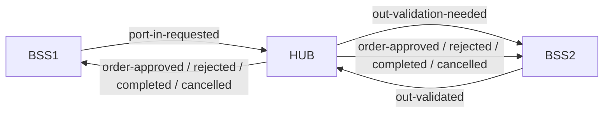
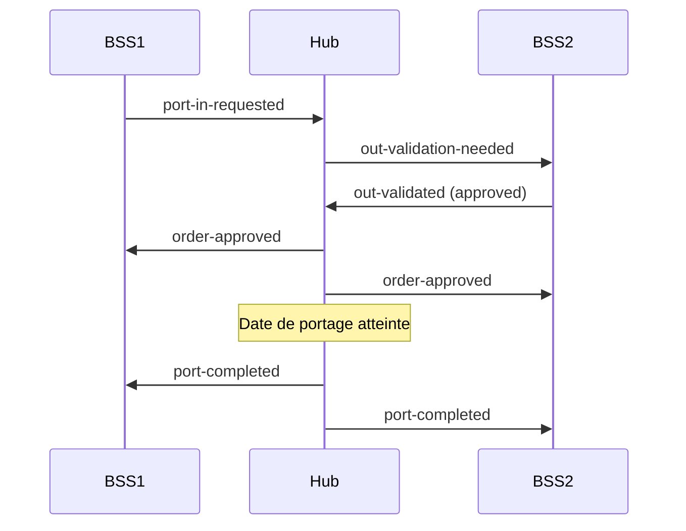
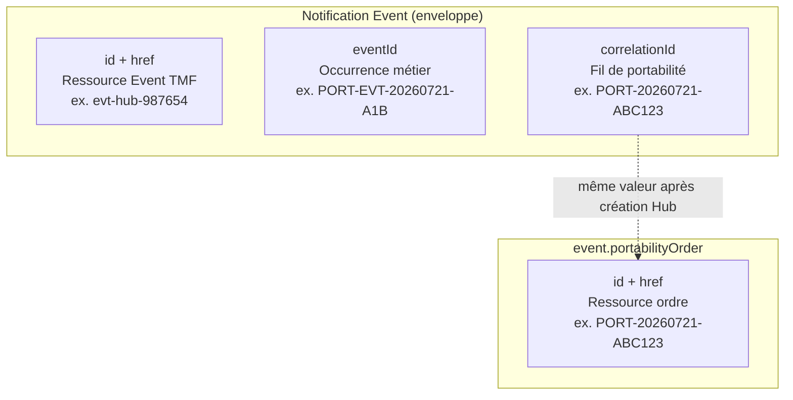

# Hub de Portabilité — Événements, chorégraphie et AsyncAPI

Document de référence pour la coordination **événementielle** du Hub de Portabilité entre opérateurs (BSS1 receveur, BSS2 donneur, Hub central).

| Projet | Rôle | Transport |
|--------|------|-----------|
| [`portabilityhub-choreography`](../) | Production événementielle (chorégraphie) | **Kafka** |
| [`portabilityhub-sync`](../../portabilityhub-sync) | Prototype REST | **Webhooks HTTP** |

Les **mêmes définitions TMF Event v4** (`EventNotification`, payloads) sont partagées entre les deux projets. Seul le canal de livraison change.

**Contrat normatif :** [`asyncapi/portability-hub.asyncapi.yaml`](asyncapi/portability-hub.asyncapi.yaml) v1.3  
**Implémentation Java :** package `com.cantelcox.portabilityhubchoreo.event` + `contract`

---

## 1. Vue d'ensemble

Le Hub de Portabilité coordonne le transfert d'un numéro téléphonique d'un opérateur donneur (BSS2) vers un opérateur receveur (BSS1).

En **chorégraphie**, aucun acteur n'orchestre les autres par REST : chaque composant **publie** et **consomme** des messages sur des topics Kafka dédiés. Le Hub reste l'autorité sur la persistance de l'ordre et la publication des changements d'état finaux.



### Acteurs

| Rôle | Responsabilité |
|------|----------------|
| **BSS1** (receveur) | Initie le port-in, reçoit les états finaux |
| **BSS2** (donneur) | Valide ou rejette la sortie OUT |
| **Hub** | Crée l'ordre, relaye la demande OUT, applique la décision BSS2, publie les états |

---

## 2. Chorégraphie vs orchestration REST

| Étape | `portabilityhub-sync` (REST) | `portabilityhub-choreography` (Kafka) |
|-------|------------------------------|---------------------------------------|
| Demande port-in | `POST /portability/order` | `PortInRequestedEvent` → `portability.port-in-requested` |
| Demande validation OUT | Webhook Hub → BSS2 | `PortabilityOrderOutValidationNeededEvent` → `portability.out-validation-needed` |
| Réponse OUT | `POST …/validate-out` | `PortabilityOrderOutValidatedEvent` → `portability.out-validated` |
| États finaux | Webhook `PortabilityOrderStateChangeEvent` | Topics `order-approved`, `order-rejected`, `port-completed`, `order-cancelled` |
| Abonnement | `POST /portability/hub` (TMF Hub) | **Non requis** — consommation Kafka par topic |

---

## 3. Contrat AsyncAPI v1.3

Fichier : [`docs/asyncapi/portability-hub.asyncapi.yaml`](asyncapi/portability-hub.asyncapi.yaml)

- **Version AsyncAPI :** 2.6.0  
- **Version contrat :** 1.3  
- **Format payload :** JSON (`application/json`)  
- **Serveur :** `kafka:9092` (production)

### 3.1 Canaux Kafka (7 topics)

| Topic | operationId | Message | eventType | Producteur | Consommateur |
|-------|-------------|---------|-----------|------------|--------------|
| `portability.port-in-requested` | `publishPortInRequested` | PortInRequested | `PortInRequestedEvent` | BSS1 | Hub |
| `portability.out-validation-needed` | `publishOutValidationNeeded` | OutValidationNeeded | `PortabilityOrderOutValidationNeededEvent` | Hub | BSS2 |
| `portability.out-validated` | `publishOutValidated` | OutValidated | `PortabilityOrderOutValidatedEvent` | BSS2 | Hub |
| `portability.order-approved` | `publishOrderApproved` | OrderApproved | `PortabilityOrderStateChangeEvent` | Hub | BSS1, BSS2 |
| `portability.order-rejected` | `publishOrderRejected` | OrderRejected | `PortabilityOrderStateChangeEvent` | Hub | BSS1, BSS2 |
| `portability.port-completed` | `publishPortCompleted` | PortCompleted | `PortabilityOrderStateChangeEvent` | Hub | BSS1, BSS2 |
| `portability.order-cancelled` | `publishOrderCancelled` | OrderCancelled | `PortabilityOrderStateChangeEvent` | Hub, BSS1 | Hub, BSS1, BSS2 |

> **Note :** les quatre derniers topics partagent le même `eventType` (`PortabilityOrderStateChangeEvent`). Le **topic Kafka** et le champ `event.portabilityOrder.status` discriminent le cas métier (`approved`, `rejected`, `port_completed`, `cancelled`).

### 3.2 Clé Kafka

Chaque publication utilise comme clé de partition :

```
correlationId  (ou eventId si correlationId absent)
```

Cela garantit l'ordre des événements **par ordre de portabilité** sur une même partition.

### 3.3 Opérations Hub (implémentation)

| Binding | operationId | Topic |
|---------|-------------|-------|
| **Consume** | `consumePortInRequested` | `port-in-requested` |
| **Consume** | `consumeOutValidated` | `out-validated` |
| **Consume** | `consumeOrderCancelled` | `order-cancelled` (initié par BSS1) |
| **Publish** | `publishOutValidationNeeded` | `out-validation-needed` |
| **Publish** | `publishOrderApproved` | `order-approved` |
| **Publish** | `publishOrderRejected` | `order-rejected` |
| **Publish** | `publishPortCompleted` | `port-completed` |
| **Publish** | `publishOrderCancelled` | `order-cancelled` (initié par Hub) |

---

## 4. Cas d'utilisation (use cases)

### UC-1 — Port-in réussi (happy path)

1. **BSS1** publie `PortInRequestedEvent` sur `port-in-requested`.
2. **Hub** consomme, crée l'ordre (`PORT-YYYYMMDD-XXXXXX`), publie `PortabilityOrderOutValidationNeededEvent`.
3. **BSS2** consomme, valide OUT (`decision: approved`), publie `PortabilityOrderOutValidatedEvent`.
4. **Hub** consomme, met à jour l'ordre, publie `PortabilityOrderStateChangeEvent` sur `order-approved`.
5. À la **date de portage** (`confirmedPortDate`), **Hub** publie sur `port-completed`.



### UC-2 — Rejet OUT

Identique à UC-1 jusqu'à l'étape 3, avec `decision: rejected` et `rejectionReason` obligatoire. Le Hub publie sur `order-rejected` (pas de `port-completed`).

### UC-3 — Annulation

- **BSS1** ou **Hub** publie `PortabilityOrderStateChangeEvent` sur `order-cancelled` (`status: cancelled`).
- Le Hub synchronise l'état interne si l'annulation vient de BSS1 (ignore sa propre republication pour éviter les boucles).

### UC-4 — Prototype REST (sync)

Même sémantique d'événements, livrés par **webhook HTTP** signé (JWT) au lieu de Kafka. Voir OpenAPI dans `portabilityhub-sync/docs/openapi/portability-hub.openapi.yaml`.

---

## 5. Structure des événements (TMF Event Management v4)

Chaque message Kafka est une enveloppe **`EventNotification`** conforme à l'Event API TMF v4.

### 5.1 Schéma racine

```json
{
  "@type": "PortInRequestedEvent",
  "@baseType": "Event",
  "id": "evt-bss1-a1b2c3",
  "href": "https://hub.example.com/tmf-api/eventManagement/v4/event/evt-bss1-a1b2c3",
  "eventId": "PORT-EVT-20260721-A1B",
  "eventTime": "2026-07-21T14:32:15.123Z",
  "eventType": "PortInRequestedEvent",
  "correlationId": "PORT-20260721-ABC123",
  "domain": "portability",
  "title": "Demande port-in",
  "description": "BSS1 publie une demande de portabilité entrante",
  "priority": "3",
  "timeOccurred": "2026-07-21T14:32:10Z",
  "source": {
    "@type": "EntityRef",
    "id": "BSS1",
    "href": "https://hub.example.com/bss1",
    "@referredType": "Application"
  },
  "event": {
    "portabilityOrder": { },
    "outValidation": { }
  }
}
```

### 5.2 Champs obligatoires

| Champ | Description |
|-------|-------------|
| `@type` | Discriminant TMF — **identique à `eventType`** |
| `@baseType` | Toujours `"Event"` |
| `id` | Identifiant **technique** de la ressource Event (unique par notification) |
| `href` | URI REST de la ressource Event (`…/tmf-api/eventManagement/v4/event/{id}`) |
| `eventId` | Identifiant **métier de l'occurrence** d'événement (voir § 5.4) |
| `eventTime` | Horodatage de création de la notification (ISO-8601) |
| `eventType` | Nom logique de l'événement (voir tableau § 3.1) |
| `correlationId` | Identifiant de **corrélation du flux** (voir § 5.5) |
| `domain` | Toujours `"portability"` |
| `event` | Payload métier (ordre, validation OUT, etc.) |

Champs optionnels usuels : `title`, `description`, `priority`, `timeOccurred`, `source`.

### 5.3 Identifiants — ne pas confondre

Le modèle TMF distingue **trois niveaux d'identifiants** :



| Identifiant | Rôle | Exemple | Génération (prototype) |
|-------------|------|---------|------------------------|
| **`id`** | ID de la **ressource Event** dans l'API TMF Event Management | `evt-hub-987654` | Préfixe acteur + UUID court (`evt-bss1-`, `evt-hub-`, `evt-bss2-`) |
| **`href`** | Lien hypermedia vers `id` | `…/tmf-api/eventManagement/v4/event/evt-hub-987654` | `{baseUrl}/tmf-api/eventManagement/v4/event/{id}` |
| **`eventId`** | ID **unique de cette occurrence** d'événement dans le domaine portabilité | `PORT-EVT-20260721-A1B` | `PORT-EVT-{YYYYMMDD}-{3 chars}` — **nouveau à chaque publication** |
| **`correlationId`** | ID qui **relie tous les événements d'un même parcours** de portabilité | `PORT-20260721-ABC123` | Voir règles ci-dessous |
| **`event.portabilityOrder.id`** | ID de l'**ordre de portabilité** (entité métier) | `PORT-20260721-ABC123` | Généré par le Hub à la création |

#### Règles de `correlationId`

| Étape | Valeur de `correlationId` |
|-------|---------------------------|
| `PortInRequestedEvent` (avant ordre Hub) | Égal au premier `eventId` de la demande (pas encore d'`orderId`) |
| Tous les événements **après création Hub** | Égal à **`orderId`** (`PORT-YYYYMMDD-XXXXXX`) |
| Clé Kafka | `correlationId` — permet de retrouver tout le fil d'un ordre |

**Exemple de fil corrélé :**

```
Événement                          correlationId              eventId
─────────────────────────────────────────────────────────────────────────
PortInRequestedEvent               PORT-EVT-20260721-001      PORT-EVT-20260721-001  ← init
OutValidationNeededEvent           PORT-20260721-ABC123       PORT-EVT-20260721-002
OutValidatedEvent                  PORT-20260721-ABC123       PORT-EVT-20260721-003
StateChangeEvent (approved)        PORT-20260721-ABC123       PORT-EVT-20260721-004
StateChangeEvent (port_completed)  PORT-20260721-ABC123       PORT-EVT-20260721-005
```

Chaque étape a un **`eventId` distinct** (nouvelle occurrence), mais le **`correlationId` reste stable** une fois l'ordre créé.

### 5.4 Payload `event`

#### `event.portabilityOrder` (`PortabilityOrderEventRef`)

Snapshot de l'ordre au moment de l'événement.

| Champ | Description |
|-------|-------------|
| `@type` | `"PortabilityOrderRef"` |
| `@referredType` | `"PortabilityOrder"` |
| `id` / `href` | Ressource ordre (présents après création Hub) |
| `number` | Numéro à porter (**obligatoire**) |
| `status` | `requested`, `pending_out_validation`, `approved`, `rejected`, `port_completed`, `cancelled` |
| `recipientOperator` / `currentOperator` | BSS receveur / donneur |
| `requestedPortDate` / `confirmedPortDate` | Dates demandées / confirmées |
| `rejectionReason` | Motif de refus ou d'annulation |
| `customerName` / `accountId` | Client receveur (BSS1) — prototype |

#### `event.outValidation` (`OutValidationResult`)

Présent uniquement sur `PortabilityOrderOutValidatedEvent`.

| Champ | Description |
|-------|-------------|
| `@type` | `"OutValidationResult"` |
| `decision` | `approved` ou `rejected` (**obligatoire**) |
| `confirmedPortDate` | Requis si `approved` |
| `rejectionReason` | Requis si `rejected` |
| `notes` | Commentaire BSS2 |

### 5.5 Types d'événements (`eventType`)

| eventType | Topic(s) | Contenu `event` |
|-----------|----------|-----------------|
| `PortInRequestedEvent` | `port-in-requested` | `portabilityOrder` seul (pas d'`id` ordre encore) |
| `PortabilityOrderOutValidationNeededEvent` | `out-validation-needed` | `portabilityOrder` (ordre créé, `status: pending_out_validation`) |
| `PortabilityOrderOutValidatedEvent` | `out-validated` | `portabilityOrder` + `outValidation` |
| `PortabilityOrderStateChangeEvent` | `order-approved`, `order-rejected`, `port-completed`, `order-cancelled` | `portabilityOrder` avec `status` terminal |

---

## 6. Schéma JSON par événement

> **Fichiers JSON Schema indépendants :** répertoire [`docs/schemas/`](schemas/) (11 fichiers, draft 2020-12, `$ref` relatifs + `examples` intégrés).

Chaque message Kafka est un document JSON `EventNotification`. Ci-dessous : **7 événements** (un par topic), avec schéma JSON Schema et exemple complet (également disponibles en fichiers `.json` séparés).

Constantes partagées dans les exemples :

| Constante | Valeur |
|-----------|--------|
| `orderId` | `PORT-20260721-ABC123` |
| `correlationId` (après création Hub) | `PORT-20260721-ABC123` |
| `number` | `5145551234` |
| `customerName` / `accountId` | `Pierre Gauthier` / `CUST-98765` |
| `baseUrl` | `https://hub.example.com` |

---

### 6.1 `PortInRequestedEvent`

**Topic :** `portability.port-in-requested` · **Producteur :** BSS1 · **Consommateur :** Hub

```json
{
  "$schema": "https://json-schema.org/draft/2020-12/schema",
  "$id": "PortInRequestedEvent",
  "title": "PortInRequestedEvent",
  "allOf": [
    { "$ref": "#/$defs/EventNotification" },
    {
      "type": "object",
      "properties": {
        "@type": { "const": "PortInRequestedEvent" },
        "eventType": { "const": "PortInRequestedEvent" },
        "event": {
          "type": "object",
          "required": ["portabilityOrder"],
          "properties": {
            "portabilityOrder": { "$ref": "#/$defs/PortabilityOrderEventRefPortIn" }
          }
        }
      }
    }
  ],
  "$defs": {
    "EventNotification": {
      "type": "object",
      "required": ["@type", "id", "href", "eventId", "eventTime", "eventType", "correlationId", "domain", "event"],
      "properties": {
        "@type": { "type": "string" },
        "@baseType": { "const": "Event" },
        "id": { "type": "string" },
        "href": { "type": "string", "format": "uri" },
        "eventId": { "type": "string" },
        "eventTime": { "type": "string", "format": "date-time" },
        "eventType": { "type": "string" },
        "correlationId": { "type": "string" },
        "domain": { "const": "portability" },
        "title": { "type": "string" },
        "description": { "type": "string" },
        "priority": { "type": "string" },
        "timeOccurred": { "type": "string", "format": "date-time" },
        "source": { "$ref": "#/$defs/EventSourceRef" },
        "event": { "type": "object" }
      }
    },
    "EventSourceRef": {
      "type": "object",
      "properties": {
        "@type": { "const": "EntityRef" },
        "id": { "type": "string" },
        "href": { "type": "string", "format": "uri" },
        "@referredType": { "const": "Application" }
      }
    },
    "PortabilityOrderEventRefPortIn": {
      "type": "object",
      "required": ["number"],
      "properties": {
        "@type": { "const": "PortabilityOrderRef" },
        "@referredType": { "const": "PortabilityOrder" },
        "number": { "type": "string" },
        "status": { "const": "requested" },
        "recipientOperator": { "type": "string" },
        "currentOperator": { "type": "string" },
        "requestedPortDate": { "type": "string", "format": "date" },
        "customerName": { "type": "string" },
        "accountId": { "type": "string" }
      }
    }
  }
}
```

**Exemple :**

```json
{
  "@type": "PortInRequestedEvent",
  "@baseType": "Event",
  "id": "evt-bss1-a1b2c3",
  "href": "https://hub.example.com/tmf-api/eventManagement/v4/event/evt-bss1-a1b2c3",
  "eventId": "PORT-EVT-20260721-001",
  "eventTime": "2026-07-21T14:30:00.000Z",
  "eventType": "PortInRequestedEvent",
  "correlationId": "PORT-EVT-20260721-001",
  "domain": "portability",
  "title": "Demande port-in",
  "description": "BSS1 publie une demande de portabilité entrante",
  "priority": "3",
  "timeOccurred": "2026-07-21T14:30:00.000Z",
  "source": {
    "@type": "EntityRef",
    "id": "BSS1",
    "href": "https://hub.example.com/bss1",
    "@referredType": "Application"
  },
  "event": {
    "portabilityOrder": {
      "@type": "PortabilityOrderRef",
      "@referredType": "PortabilityOrder",
      "number": "5145551234",
      "status": "requested",
      "recipientOperator": "BSS1",
      "currentOperator": "BSS2",
      "requestedPortDate": "2026-07-25",
      "customerName": "Pierre Gauthier",
      "accountId": "CUST-98765"
    }
  }
}
```

> `correlationId` = `eventId` tant que l'ordre Hub n'existe pas encore.

---

### 6.2 `PortabilityOrderOutValidationNeededEvent`

**Topic :** `portability.out-validation-needed` · **Producteur :** Hub · **Consommateur :** BSS2

```json
{
  "$schema": "https://json-schema.org/draft/2020-12/schema",
  "$id": "PortabilityOrderOutValidationNeededEvent",
  "title": "PortabilityOrderOutValidationNeededEvent",
  "allOf": [
    { "$ref": "#/$defs/EventNotification" },
    {
      "type": "object",
      "properties": {
        "@type": { "const": "PortabilityOrderOutValidationNeededEvent" },
        "eventType": { "const": "PortabilityOrderOutValidationNeededEvent" },
        "event": {
          "type": "object",
          "required": ["portabilityOrder"],
          "properties": {
            "portabilityOrder": { "$ref": "#/$defs/PortabilityOrderEventRefWithId" }
          }
        }
      }
    }
  ],
  "$defs": {
    "EventNotification": { "$ref": "PortInRequestedEvent#/$defs/EventNotification" },
    "PortabilityOrderEventRefWithId": {
      "type": "object",
      "required": ["id", "href", "number", "status"],
      "properties": {
        "@type": { "const": "PortabilityOrderRef" },
        "@referredType": { "const": "PortabilityOrder" },
        "id": { "type": "string" },
        "href": { "type": "string", "format": "uri" },
        "number": { "type": "string" },
        "status": { "const": "pending_out_validation" },
        "recipientOperator": { "type": "string" },
        "currentOperator": { "type": "string" },
        "requestedPortDate": { "type": "string", "format": "date" },
        "customerName": { "type": "string" },
        "accountId": { "type": "string" }
      }
    }
  }
}
```

**Exemple :**

```json
{
  "@type": "PortabilityOrderOutValidationNeededEvent",
  "@baseType": "Event",
  "id": "evt-hub-b2c3d4",
  "href": "https://hub.example.com/tmf-api/eventManagement/v4/event/evt-hub-b2c3d4",
  "eventId": "PORT-EVT-20260721-002",
  "eventTime": "2026-07-21T14:30:05.000Z",
  "eventType": "PortabilityOrderOutValidationNeededEvent",
  "correlationId": "PORT-20260721-ABC123",
  "domain": "portability",
  "title": "Validation OUT requise",
  "description": "Le BSS donneur doit valider la portabilité",
  "priority": "2",
  "timeOccurred": "2026-07-21T14:30:00.000Z",
  "source": {
    "@type": "EntityRef",
    "id": "PortabilityHub",
    "href": "https://hub.example.com",
    "@referredType": "Application"
  },
  "event": {
    "portabilityOrder": {
      "@type": "PortabilityOrderRef",
      "@referredType": "PortabilityOrder",
      "id": "PORT-20260721-ABC123",
      "href": "https://hub.example.com/portability/order/PORT-20260721-ABC123",
      "number": "5145551234",
      "status": "pending_out_validation",
      "recipientOperator": "BSS1",
      "currentOperator": "BSS2",
      "requestedPortDate": "2026-07-25",
      "customerName": "Pierre Gauthier",
      "accountId": "CUST-98765"
    }
  }
}
```

---

### 6.3 `PortabilityOrderOutValidatedEvent`

**Topic :** `portability.out-validated` · **Producteur :** BSS2 · **Consommateur :** Hub

```json
{
  "$schema": "https://json-schema.org/draft/2020-12/schema",
  "$id": "PortabilityOrderOutValidatedEvent",
  "title": "PortabilityOrderOutValidatedEvent",
  "allOf": [
    { "$ref": "#/$defs/EventNotification" },
    {
      "type": "object",
      "properties": {
        "@type": { "const": "PortabilityOrderOutValidatedEvent" },
        "eventType": { "const": "PortabilityOrderOutValidatedEvent" },
        "event": {
          "type": "object",
          "required": ["portabilityOrder", "outValidation"],
          "properties": {
            "portabilityOrder": { "$ref": "#/$defs/PortabilityOrderEventRefWithId" },
            "outValidation": { "$ref": "#/$defs/OutValidationResult" }
          }
        }
      }
    }
  ],
  "$defs": {
    "EventNotification": { "$ref": "PortInRequestedEvent#/$defs/EventNotification" },
    "PortabilityOrderEventRefWithId": { "$ref": "PortabilityOrderOutValidationNeededEvent#/$defs/PortabilityOrderEventRefWithId" },
    "OutValidationResult": {
      "type": "object",
      "required": ["decision"],
      "properties": {
        "@type": { "const": "OutValidationResult" },
        "decision": { "type": "string", "enum": ["approved", "rejected"] },
        "confirmedPortDate": { "type": "string", "format": "date" },
        "rejectionReason": { "type": "string" },
        "notes": { "type": "string" }
      }
    }
  }
}
```

**Exemple (approved) :**

```json
{
  "@type": "PortabilityOrderOutValidatedEvent",
  "@baseType": "Event",
  "id": "evt-bss2-c3d4e5",
  "href": "https://hub.example.com/tmf-api/eventManagement/v4/event/evt-bss2-c3d4e5",
  "eventId": "PORT-EVT-20260721-003",
  "eventTime": "2026-07-21T14:35:00.000Z",
  "eventType": "PortabilityOrderOutValidatedEvent",
  "correlationId": "PORT-20260721-ABC123",
  "domain": "portability",
  "title": "Validation OUT soumise",
  "description": "BSS2 répond à la demande de validation OUT",
  "priority": "2",
  "timeOccurred": "2026-07-21T14:35:00.000Z",
  "source": {
    "@type": "EntityRef",
    "id": "BSS2",
    "href": "https://hub.example.com/bss2",
    "@referredType": "Application"
  },
  "event": {
    "portabilityOrder": {
      "@type": "PortabilityOrderRef",
      "@referredType": "PortabilityOrder",
      "id": "PORT-20260721-ABC123",
      "href": "https://hub.example.com/portability/order/PORT-20260721-ABC123",
      "number": "5145551234",
      "status": "pending_out_validation",
      "recipientOperator": "BSS1",
      "currentOperator": "BSS2",
      "requestedPortDate": "2026-07-25",
      "customerName": "Pierre Gauthier",
      "accountId": "CUST-98765"
    },
    "outValidation": {
      "@type": "OutValidationResult",
      "decision": "approved",
      "confirmedPortDate": "2026-07-25",
      "notes": "Conforme de notre côté"
    }
  }
}
```

**Exemple (rejected) — même schéma, `decision: rejected` :**

```json
{
  "@type": "PortabilityOrderOutValidatedEvent",
  "@baseType": "Event",
  "id": "evt-bss2-x9y8z7",
  "href": "https://hub.example.com/tmf-api/eventManagement/v4/event/evt-bss2-x9y8z7",
  "eventId": "PORT-EVT-20260721-003",
  "eventTime": "2026-07-21T14:35:00.000Z",
  "eventType": "PortabilityOrderOutValidatedEvent",
  "correlationId": "PORT-20260721-ABC123",
  "domain": "portability",
  "source": {
    "@type": "EntityRef",
    "id": "BSS2",
    "href": "https://hub.example.com/bss2",
    "@referredType": "Application"
  },
  "event": {
    "portabilityOrder": {
      "@type": "PortabilityOrderRef",
      "@referredType": "PortabilityOrder",
      "id": "PORT-20260721-ABC123",
      "href": "https://hub.example.com/portability/order/PORT-20260721-ABC123",
      "number": "5145551234",
      "status": "pending_out_validation"
    },
    "outValidation": {
      "@type": "OutValidationResult",
      "decision": "rejected",
      "rejectionReason": "Account mismatch",
      "notes": "Autorisation invalide"
    }
  }
}
```

---

### 6.4 `PortabilityOrderStateChangeEvent` — order approved

**Topic :** `portability.order-approved` · **Producteur :** Hub · **Consommateurs :** BSS1, BSS2

```json
{
  "$schema": "https://json-schema.org/draft/2020-12/schema",
  "$id": "PortabilityOrderStateChangeEvent-approved",
  "title": "PortabilityOrderStateChangeEvent (approved)",
  "allOf": [
    { "$ref": "#/$defs/EventNotification" },
    {
      "type": "object",
      "properties": {
        "@type": { "const": "PortabilityOrderStateChangeEvent" },
        "eventType": { "const": "PortabilityOrderStateChangeEvent" },
        "event": {
          "type": "object",
          "required": ["portabilityOrder"],
          "properties": {
            "portabilityOrder": {
              "allOf": [
                { "$ref": "#/$defs/PortabilityOrderEventRefWithId" },
                { "properties": { "status": { "const": "approved" } } }
              ]
            }
          }
        }
      }
    }
  ],
  "$defs": {
    "EventNotification": { "$ref": "PortInRequestedEvent#/$defs/EventNotification" },
    "PortabilityOrderEventRefWithId": { "$ref": "PortabilityOrderOutValidationNeededEvent#/$defs/PortabilityOrderEventRefWithId" }
  }
}
```

**Exemple :**

```json
{
  "@type": "PortabilityOrderStateChangeEvent",
  "@baseType": "Event",
  "id": "evt-hub-d4e5f6",
  "href": "https://hub.example.com/tmf-api/eventManagement/v4/event/evt-hub-d4e5f6",
  "eventId": "PORT-EVT-20260721-004",
  "eventTime": "2026-07-21T14:35:01.000Z",
  "eventType": "PortabilityOrderStateChangeEvent",
  "correlationId": "PORT-20260721-ABC123",
  "domain": "portability",
  "title": "Portabilité approuvée",
  "description": "La validation OUT a été approuvée",
  "priority": "3",
  "timeOccurred": "2026-07-21T14:35:01.000Z",
  "source": {
    "@type": "EntityRef",
    "id": "PortabilityHub",
    "href": "https://hub.example.com",
    "@referredType": "Application"
  },
  "event": {
    "portabilityOrder": {
      "@type": "PortabilityOrderRef",
      "@referredType": "PortabilityOrder",
      "id": "PORT-20260721-ABC123",
      "href": "https://hub.example.com/portability/order/PORT-20260721-ABC123",
      "number": "5145551234",
      "status": "approved",
      "recipientOperator": "BSS1",
      "currentOperator": "BSS2",
      "requestedPortDate": "2026-07-25",
      "confirmedPortDate": "2026-07-25",
      "customerName": "Pierre Gauthier",
      "accountId": "CUST-98765"
    }
  }
}
```

---

### 6.5 `PortabilityOrderStateChangeEvent` — order rejected

**Topic :** `portability.order-rejected` · **Producteur :** Hub · **Consommateurs :** BSS1, BSS2

```json
{
  "$schema": "https://json-schema.org/draft/2020-12/schema",
  "$id": "PortabilityOrderStateChangeEvent-rejected",
  "title": "PortabilityOrderStateChangeEvent (rejected)",
  "allOf": [
    { "$ref": "PortabilityOrderStateChangeEvent-approved#/$defs/EventNotification" },
    {
      "type": "object",
      "properties": {
        "event": {
          "properties": {
            "portabilityOrder": {
              "properties": {
                "status": { "const": "rejected" },
                "rejectionReason": { "type": "string" }
              },
              "required": ["rejectionReason"]
            }
          }
        }
      }
    }
  ]
}
```

**Exemple :**

```json
{
  "@type": "PortabilityOrderStateChangeEvent",
  "@baseType": "Event",
  "id": "evt-hub-e5f6g7",
  "href": "https://hub.example.com/tmf-api/eventManagement/v4/event/evt-hub-e5f6g7",
  "eventId": "PORT-EVT-20260721-004",
  "eventTime": "2026-07-21T14:35:01.000Z",
  "eventType": "PortabilityOrderStateChangeEvent",
  "correlationId": "PORT-20260721-ABC123",
  "domain": "portability",
  "title": "Portabilité refusée",
  "description": "La validation OUT a été refusée",
  "priority": "2",
  "timeOccurred": "2026-07-21T14:35:01.000Z",
  "source": {
    "@type": "EntityRef",
    "id": "PortabilityHub",
    "href": "https://hub.example.com",
    "@referredType": "Application"
  },
  "event": {
    "portabilityOrder": {
      "@type": "PortabilityOrderRef",
      "@referredType": "PortabilityOrder",
      "id": "PORT-20260721-ABC123",
      "href": "https://hub.example.com/portability/order/PORT-20260721-ABC123",
      "number": "5145551234",
      "status": "rejected",
      "recipientOperator": "BSS1",
      "currentOperator": "BSS2",
      "rejectionReason": "Account mismatch",
      "customerName": "Pierre Gauthier",
      "accountId": "CUST-98765"
    }
  }
}
```

---

### 6.6 `PortabilityOrderStateChangeEvent` — port completed

**Topic :** `portability.port-completed` · **Producteur :** Hub · **Consommateurs :** BSS1, BSS2

```json
{
  "$schema": "https://json-schema.org/draft/2020-12/schema",
  "$id": "PortabilityOrderStateChangeEvent-port_completed",
  "title": "PortabilityOrderStateChangeEvent (port_completed)",
  "allOf": [
    { "$ref": "PortabilityOrderStateChangeEvent-approved#/$defs/EventNotification" },
    {
      "type": "object",
      "properties": {
        "event": {
          "properties": {
            "portabilityOrder": {
              "properties": {
                "status": { "const": "port_completed" },
                "confirmedPortDate": { "type": "string", "format": "date" }
              }
            }
          }
        }
      }
    }
  ]
}
```

**Exemple :**

```json
{
  "@type": "PortabilityOrderStateChangeEvent",
  "@baseType": "Event",
  "id": "evt-hub-f6g7h8",
  "href": "https://hub.example.com/tmf-api/eventManagement/v4/event/evt-hub-f6g7h8",
  "eventId": "PORT-EVT-20260721-005",
  "eventTime": "2026-07-25T08:00:00.000Z",
  "eventType": "PortabilityOrderStateChangeEvent",
  "correlationId": "PORT-20260721-ABC123",
  "domain": "portability",
  "title": "Portabilité terminée",
  "description": "Le transfert du numéro est complété",
  "priority": "3",
  "timeOccurred": "2026-07-25T08:00:00.000Z",
  "source": {
    "@type": "EntityRef",
    "id": "PortabilityHub",
    "href": "https://hub.example.com",
    "@referredType": "Application"
  },
  "event": {
    "portabilityOrder": {
      "@type": "PortabilityOrderRef",
      "@referredType": "PortabilityOrder",
      "id": "PORT-20260721-ABC123",
      "href": "https://hub.example.com/portability/order/PORT-20260721-ABC123",
      "number": "5145551234",
      "status": "port_completed",
      "recipientOperator": "BSS1",
      "currentOperator": "BSS2",
      "requestedPortDate": "2026-07-25",
      "confirmedPortDate": "2026-07-25",
      "customerName": "Pierre Gauthier",
      "accountId": "CUST-98765"
    }
  }
}
```

---

### 6.7 `PortabilityOrderStateChangeEvent` — order cancelled

**Topic :** `portability.order-cancelled` · **Producteur :** Hub ou BSS1 · **Consommateurs :** Hub, BSS1, BSS2

```json
{
  "$schema": "https://json-schema.org/draft/2020-12/schema",
  "$id": "PortabilityOrderStateChangeEvent-cancelled",
  "title": "PortabilityOrderStateChangeEvent (cancelled)",
  "allOf": [
    { "$ref": "PortabilityOrderStateChangeEvent-approved#/$defs/EventNotification" },
    {
      "type": "object",
      "properties": {
        "event": {
          "properties": {
            "portabilityOrder": {
              "properties": {
                "status": { "const": "cancelled" },
                "rejectionReason": { "type": "string", "description": "Motif d'annulation" }
              }
            }
          }
        }
      }
    }
  ]
}
```

**Exemple (annulation initiée par BSS1) :**

```json
{
  "@type": "PortabilityOrderStateChangeEvent",
  "@baseType": "Event",
  "id": "evt-bss1-g7h8i9",
  "href": "https://hub.example.com/tmf-api/eventManagement/v4/event/evt-bss1-g7h8i9",
  "eventId": "PORT-EVT-20260721-006",
  "eventTime": "2026-07-21T15:00:00.000Z",
  "eventType": "PortabilityOrderStateChangeEvent",
  "correlationId": "PORT-20260721-ABC123",
  "domain": "portability",
  "title": "Portabilité annulée",
  "description": "L'ordre de portabilité a été annulé",
  "priority": "2",
  "timeOccurred": "2026-07-21T15:00:00.000Z",
  "source": {
    "@type": "EntityRef",
    "id": "BSS1",
    "href": "https://hub.example.com/bss1",
    "@referredType": "Application"
  },
  "event": {
    "portabilityOrder": {
      "@type": "PortabilityOrderRef",
      "@referredType": "PortabilityOrder",
      "id": "PORT-20260721-ABC123",
      "href": "https://hub.example.com/portability/order/PORT-20260721-ABC123",
      "number": "5145551234",
      "status": "cancelled",
      "recipientOperator": "BSS1",
      "currentOperator": "BSS2",
      "rejectionReason": "Client a retiré sa demande",
      "customerName": "Pierre Gauthier",
      "accountId": "CUST-98765"
    }
  }
}
```

---

### 6.8 Récapitulatif des identifiants par événement

| # | Topic | eventType | eventId (ex.) | correlationId | source.id |
|---|-------|-----------|---------------|---------------|-----------|
| 1 | `port-in-requested` | `PortInRequestedEvent` | `PORT-EVT-…-001` | `PORT-EVT-…-001` | BSS1 |
| 2 | `out-validation-needed` | `PortabilityOrderOutValidationNeededEvent` | `PORT-EVT-…-002` | `PORT-…-ABC123` | PortabilityHub |
| 3 | `out-validated` | `PortabilityOrderOutValidatedEvent` | `PORT-EVT-…-003` | `PORT-…-ABC123` | BSS2 |
| 4 | `order-approved` | `PortabilityOrderStateChangeEvent` | `PORT-EVT-…-004` | `PORT-…-ABC123` | PortabilityHub |
| 5 | `order-rejected` | `PortabilityOrderStateChangeEvent` | `PORT-EVT-…-004` | `PORT-…-ABC123` | PortabilityHub |
| 6 | `port-completed` | `PortabilityOrderStateChangeEvent` | `PORT-EVT-…-005` | `PORT-…-ABC123` | PortabilityHub |
| 7 | `order-cancelled` | `PortabilityOrderStateChangeEvent` | `PORT-EVT-…-006` | `PORT-…-ABC123` | BSS1 ou PortabilityHub |

> Chaque publication génère un **`eventId` unique** et un **`id`** Event distinct (`evt-*`). Le **`correlationId`** reste `PORT-…-ABC123` pour tous les événements après création de l'ordre.

---

## 7. Validation du contrat

Le package `contract` valide chaque événement avant publication Kafka :

- Enveloppe TMF (`@type`, `eventType`, `domain`, champs obligatoires)
- Cohérence `eventType` ↔ canal AsyncAPI
- Payload selon le type (`portabilityOrder.number`, `outValidation.decision`, `status` attendu pour les state change)

Tests : `AsyncApiContractTest`, `PortabilityHubAsyncApiTest`.

---

## 8. Ressources

| Ressource | Emplacement |
|-----------|-------------|
| AsyncAPI v1.3 | [`docs/asyncapi/portability-hub.asyncapi.yaml`](asyncapi/portability-hub.asyncapi.yaml) |
| **JSON Schema (événements)** | [`docs/schemas/`](schemas/) |
| OpenAPI (sync, mêmes schémas) | `portabilityhub-sync/docs/openapi/portability-hub.openapi.yaml` |
| DTO Java | `src/main/java/.../event/EventNotification.java` |
| Factory | `src/main/java/.../event/EventNotificationFactory.java` |
| Canaux / validateur | `src/main/java/.../contract/` |
| Simulateur chorégraphie | http://localhost:8383/simulator/ |
| Simulateur sync | http://localhost:8082/simulator/ |

---

*Hub de Portabilité — ETS LOG 430 / LOG 660 — Contrat événements v1.3*
